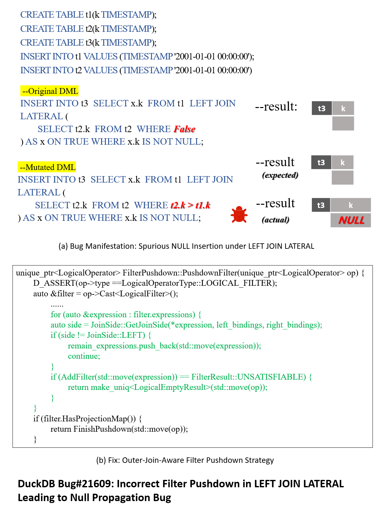
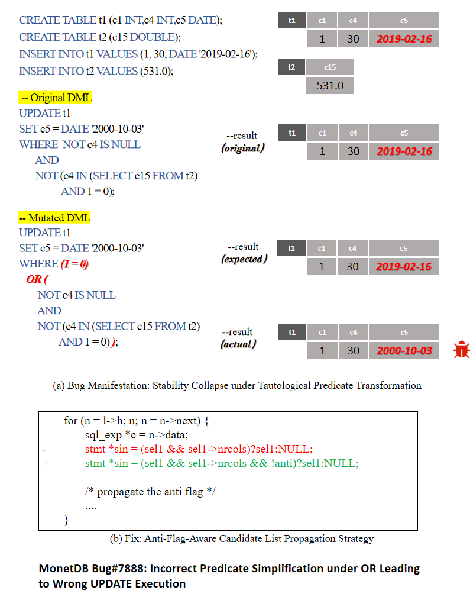

# Case Study

### DuckDB Bug #21609

https://github.com/duckdb/duckdb/issues/21609

The bug manifests as an incorrect state transition in INSERT INTO ... SELECT with LEFT JOIN LATERAL. As shown in Figure (a), the original statement uses WHERE FALSE inside the lateral subquery, while the mutated statement replaces it with WHERE t2.k > t1.k. Under the given database state, both predicates are unsatisfied, so neither statement should produce any valid tuple for insertion, and table t3 is expected to remain empty. However, DuckDB incorrectly inserts one row with a NULL value into t3. This behavior indicates a silent logical bug: the statement executes without raising an error, but produces an incorrect database state by preserving a row that should have been filtered out.

The root cause is an incorrect filter pushdown around LEFT JOIN LATERAL. In this query, the outer predicate WHERE x.k IS NOT NULL must be evaluated after the left join, because its role is to remove the null-extended rows generated when the lateral subquery produces no match. However, DuckDB mishandles this predicate during optimization and effectively breaks the null-preserving semantics of the outer join. As a result, an unmatched left-side row is still retained, and the NULL value from the lateral side is propagated into the final insertion result. In essence, the optimizer treats a post-join filter as if it could be safely pushed into the join process, which is semantically invalid for predicates depending on the right side of a left join.

The fix is to make filter pushdown outer-join aware. As illustrated in Figure (b), during optimization, each filter expression should be analyzed individually to determine which side of the join it depends on. For LEFT JOIN, only predicates that refer exclusively to the left side can be safely pushed down. Predicates involving the right side, especially those such as x.k IS NOT NULL that distinguish null-extended rows from real matches, must remain above the join. By preserving these filters after the join, the optimizer maintains the correct null semantics of LEFT JOIN LATERAL and prevents spurious NULL rows from being inserted into the target table.

### **MonetDB** **Bug #7888**
https://github.com/MonetDB/MonetDB/issues/7888

The bug manifests as a wrong state transition in UPDATE under a tautological predicate transformation. As shown in Figure (a), the original and mutated predicates are logically equivalent, where the mutated form introduces an OR branch (1=0 OR ...) that should not change the selected row set. Under the given database state, both statements should leave t1.c5 unchanged (2019-02-16). However, MonetDB updates the row to 2000-10-03 after mutation. This is a silent logic bug: execution succeeds, but the final database state violates semantic approximation.

The root cause is incorrect predicate handling around OR when anti semantics (e.g., NOT IN-style filtering) are involved. During optimization/planning, MonetDB simplifies or rewrites the predicate but fails to preserve anti-aware selection semantics in the internal candidate propagation path. As a result, rows that should be excluded by the anti condition can be treated as update candidates, which makes an equivalence-preserving mutation produce a different update effect.

The fix is to propagate anti semantics explicitly in the selection construction path, as illustrated in Figure (b). Concretely, the implementation changes stmt *sin = (sell && sell->nrcols)?sel1:NULL; to stmt *sin = (sell && sell->nrcols && !anti)?sel1:NULL;, i.e., the anti flag is carried into candidate-list generation. By making this path anti-aware, MonetDB avoids incorrect predicate simplification effects under OR and restores stable, semantically correct UPDATE behavior.

